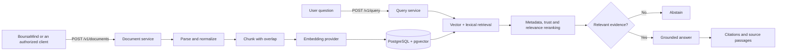

# BoursaMind-RAG

BoursaMind-RAG is the independent retrieval-augmented generation service used by
[BoursaMind](https://github.com/jemaiihamza0-hash/BoursaMind). It exposes a
multi-tenant HTTP API for document ingestion, chunking, embeddings, hybrid
retrieval, grounded answer generation, citations, financial context and
evaluation.

The service owns documentary evidence and retrieval. BoursaMind remains the
source of truth for users, companies, market data, financial validation and
source acquisition rights.

## How it works



1. A client submits text, Markdown or PDF content with provenance metadata.
2. The service creates or replaces the document idempotently using an optional
   external identifier.
3. Text is split into overlapping chunks and embedded.
4. Chunks, embedding-model identity, metadata and visibility grants are stored
   in the service's own database.
5. A query is embedded and matched against compatible indexed chunks.
6. Candidates are reranked using vector similarity, BM25-style lexical score,
   query coverage, metadata match and source trust.
7. If no result clears the configured relevance threshold, the service
   abstains. Otherwise it returns a grounded answer and resolvable citations.

See [Architecture](docs/ARCHITECTURE.md) for the complete request and data flow.

## Responsibilities

The service provides:

- tenant, workspace and collection isolation;
- scoped API-key authentication;
- text, Markdown and PDF ingestion;
- deterministic or OpenAI embeddings and answer generation;
- PostgreSQL/pgvector retrieval with embedding-space compatibility checks;
- lexical/vector reranking, metadata filters and no-answer behavior;
- exact source passages, page information and financial provenance metadata;
- owner-scoped document visibility inside a tenant;
- financial query orchestration through a controlled BoursaMind bridge;
- usage quotas, job state, diagnostics and evaluation datasets;
- optional public-data connectors stored separately from document embeddings.

It does **not** own BVMT/CMF/BCT collection, market normalization, issuer
identity, portfolio logic or financial-record validation. Those remain in the
main BoursaMind application.

## Repository layout

```text
app/api/               Core HTTP endpoints
app/auth/              API keys, scopes and principals
app/documents/         Ingestion, replacement and indexing jobs
app/chunking/          Page-aware chunking and overlap
app/embeddings/        Deterministic and OpenAI embeddings
app/retrieval/         Candidate selection and hybrid reranking
app/generation/        Deterministic and OpenAI answer providers
app/citations/         Exact source resolution
app/financial/         Financial intent, tools and user memory
app/external_sources/  Optional public-data connectors
app/evaluation/        Evaluation datasets and metrics
alembic/               Managed PostgreSQL schema migrations
tests/                 API, security, migration and performance tests
docs/                  Contracts, architecture and operations
```

## Quick start

Requirements: Python 3.12+.

```bash
python -m venv .venv
# Windows: .venv\Scripts\activate
# Linux/macOS: source .venv/bin/activate
python -m pip install -r requirements-ci.txt
cp .env.example .env
uvicorn app.main:app --host 127.0.0.1 --port 8001
```

On Windows PowerShell, replace `cp` with:

```powershell
Copy-Item .env.example .env
```

Development defaults use SQLite and deterministic providers. They do not need
an OpenAI key. Confirm readiness:

```bash
curl http://127.0.0.1:8001/v1/health/ready
```

The development bootstrap key is `dev-boursamind-rag-key`. Never use it in a
deployed environment.

## Docker development stack

```bash
docker compose up --build
```

This starts PostgreSQL with pgvector, runs `alembic upgrade head` as a one-shot
migration gate, and then starts the API on `127.0.0.1:8001`.

## Authentication

Tenant endpoints accept:

```text
X-BoursaMind-RAG-Key: <tenant API key>
```

`X-BoursaMind-Key` is retained as a compatibility header. Tenant creation uses
the separate `X-BoursaMind-RAG-Admin-Key` header. Keys are stored as SHA-256
hashes and may be limited to `query:read`, `documents:write` and `usage:read`.

## Main API

```text
GET  /v1/health
GET  /v1/health/live
GET  /v1/health/ready
GET  /v1/status
GET  /v1/diagnostics
POST /v1/documents
POST /v1/documents/upload
GET  /v1/documents
POST /v1/index
GET  /v1/jobs
POST /v1/jobs/{job_id}/retry
POST /v1/query
GET  /v1/sources/{chunk_id}
GET  /v1/usage
POST /v1/evaluation/run
```

Financial endpoints are under `/v1/financial`; optional provider endpoints are
under `/v1/external`. The complete contract is in
[API_CONTRACT.md](docs/API_CONTRACT.md).

### Ingest a document

```bash
curl -X POST http://127.0.0.1:8001/v1/documents \
  -H "Content-Type: application/json" \
  -H "X-BoursaMind-RAG-Key: dev-boursamind-rag-key" \
  -d '{
    "title": "Annual report",
    "text": "Verified document text",
    "document_type": "official_publication",
    "source_url": "https://example.org/report.pdf",
    "external_id": "issuer-report-2025",
    "metadata": {
      "ticker": "EXAMPLE",
      "reporting_period": "2025",
      "is_official": true
    },
    "index_now": true
  }'
```

### Query indexed evidence

```bash
curl -X POST http://127.0.0.1:8001/v1/query \
  -H "Content-Type: application/json" \
  -H "X-BoursaMind-RAG-Key: dev-boursamind-rag-key" \
  -d '{
    "query": "What does the annual report say?",
    "filters": {"ticker": "EXAMPLE"},
    "top_k": 5
  }'
```

Every citation contains a chunk identifier. Resolve the exact stored passage
with `GET /v1/sources/{chunk_id}`.

## BoursaMind integration

The main application communicates with this service over HTTP:

```env
RAG_MODE=REMOTE
BOURSAMIND_RAG_URL=http://boursamind-rag:8001
BOURSAMIND_RAG_API_KEY=<same generated bootstrap key>
```

The reverse bridge used by controlled financial tools is disabled until both
`BOURSAMIND_RAG_BOURSAMIND_API_URL` and
`BOURSAMIND_RAG_BOURSAMIND_SERVICE_KEY` are configured.

## Database migrations

The current Alembic head is `0008_remove_weather_events`.

```bash
alembic current
alembic upgrade head
```

Production startup does not create tables automatically. Migrations must finish
before the API starts. See [Operations](docs/OPERATIONS.md).

## Tests

```bash
python -m ruff check app tests
python -m pytest
```

The test suite uses disposable databases and deterministic providers. It must
not call a developer's BoursaMind instance or OpenAI account.

## Security principles

- Production configuration fails closed when secrets or database settings are unsafe.
- Documents and citations are filtered by tenant and optional owner grants.
- Retrieved document text is treated as evidence, never as system instructions.
- Uploads are allowlisted and size-limited.
- Logs and diagnostics exclude credentials, prompts and document bodies.
- Provider failures do not expose raw exception text through HTTP responses.
- Deployment examples use read-only containers, dropped capabilities and private networks.

Read [Tenancy and security](docs/TENANCY_AND_SECURITY.md) before integrating a
new client or provider.

## Documentation

- [Architecture and data flow](docs/ARCHITECTURE.md)
- [API contract](docs/API_CONTRACT.md)
- [Operations and deployment](docs/OPERATIONS.md)
- [Tenancy and security](docs/TENANCY_AND_SECURITY.md)
- [BoursaMind backfill strategy](docs/BOURSAMIND_BACKFILL.md)
- [External data sources](docs/EXTERNAL_DATA_SOURCES.md)
- [Evaluation notes](docs/RAGAS_REFERENCE_NOTES.md)
