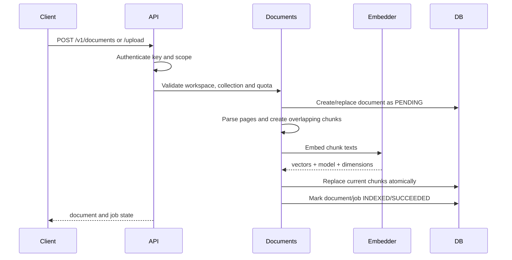
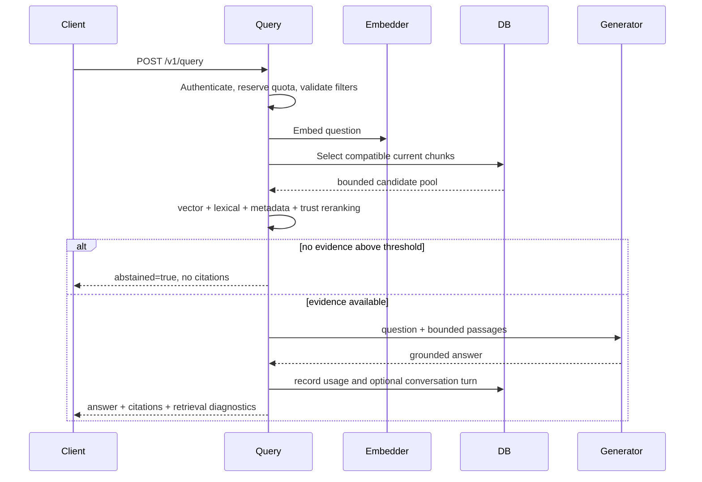

# Architecture and data flow

## Service boundary

BoursaMind-RAG is deployed and migrated independently from BoursaMind. The two
applications share neither Python imports nor database tables. BoursaMind sends
authorized documentary material over HTTP and keeps responsibility for source
rights, issuer identity, financial validation and user-facing business logic.

## Runtime components

- **FastAPI API**: authentication, request validation and orchestration.
- **PostgreSQL + pgvector**: tenants, keys, documents, chunks, jobs, usage,
  conversations, memory and optional external events.
- **Embedding provider**: deterministic vectors for tests/development or OpenAI
  embeddings when explicitly enabled.
- **Generation provider**: deterministic evidence excerpts or an OpenAI chat
  model when explicitly enabled.
- **Alembic**: the only production schema-management path.

## Ingestion lifecycle

`external_id` makes ingestion idempotent inside a tenant collection. A
replacement is not returned as current evidence while it is pending or failed.
Old chunks can remain available for operational recovery but are excluded from
normal retrieval until the replacement succeeds.

Each chunk preserves tenant, workspace, collection, document, provenance,
page, content hash, embedding-model identity and arbitrary domain metadata.

## Query lifecycle

PostgreSQL deployments can preselect candidates with pgvector distance. Final
ranking combines cosine similarity, BM25-style lexical relevance, query-term
coverage, metadata signals and source trust.

Only chunks generated by the same embedding model and dimension as the query
are eligible. This permits controlled embedding migrations without mixing
incompatible vector spaces.

## Citation contract

A citation is a stable reference to a stored chunk containing the document,
passage index, page, source URL, issuer, reporting period, statement scope,
document version and validation metadata. `GET /v1/sources/{chunk_id}` resolves
it under the same tenant and owner rules.

## Multi-tenancy and visibility

Every retrievable row carries `tenant_id`. Tenant keys are hashed and scopes are
checked before service code executes. Workspaces and collections organize data
inside one tenant.

Documents may also have owner grants. A query without `visibility_owner` sees
tenant-public documents only. A query with an owner sees public documents plus
documents granted to that owner. Visibility changes are durable and idempotent.

## Financial orchestration

`/v1/financial/query` classifies intent, selects allowlisted financial tools and
retrieves documentary evidence. Live structured values are requested only
through the configured internal BoursaMind bridge. The RAG service does not
create or validate market prices or financial statements.

## External events

Optional GDELT, INS and Meta connectors persist normalized events and
raw provider payloads in `external_events`. This store is tenant-scoped but is
separate from document retrieval. Provider errors are isolated from core RAG.

## Observability

Responses receive request and correlation identifiers. The service records
aggregate latency, request counts, index freshness, job states and usage. It
does not expose secrets, prompts, document bodies or raw provider exceptions in
diagnostic responses.
